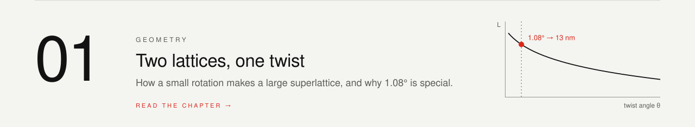
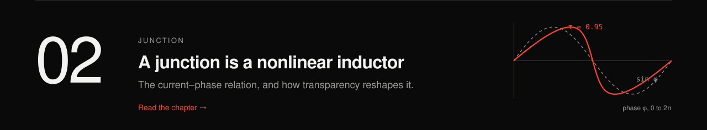
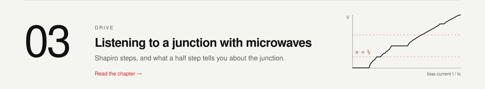
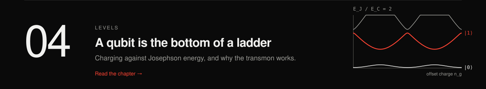
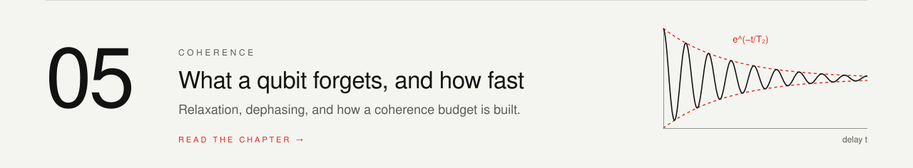
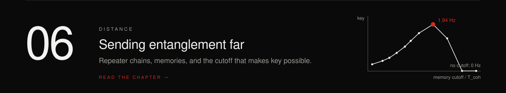
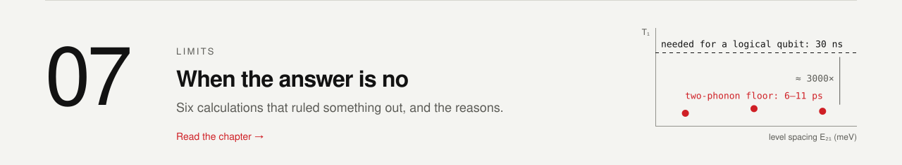

These notes explain the physics behind my work — how twisted lattices, Josephson junctions and qubits behave, what limits their coherence, and how entanglement is carried over distance. Each chapter at **[faruksamibilgin.github.io](https://faruksamibilgin.github.io)** has a figure you can change; the small figures above are computed from the same equations, and each chapter ends with the calculation, code and data in a public repository. A longer piece, **[The Josephson junction](https://faruksamibilgin.github.io/josephson/)**, goes from a chip you can rotate to a qubit you can drive.

&nbsp;

### Papers, code and data

1. **Testing the twisted-hBN artificial-atom proposal by registry-resolved DFT** — a symmetry-forbidden potential form, a three-to-fourfold-weaker well, and what survives. Preprint, 2026.
   [Zenodo](https://doi.org/10.5281/zenodo.24201814) · [alphaXiv](https://www.alphaxiv.org/abs/2611.twisted-hbn-artificial-atoms-registry-dft) · [code and data](https://github.com/FarukSamiBilgin/twisted-hbn-artificial-atoms)
2. **Twisted bilayer MoS₂ cannot talk to light** — a Γ-valley hole spin memory and its isotope-purification coherence budget. Preprint, 2026.
   [alphaXiv](https://www.alphaxiv.org/abs/2611.twisted-mos2-hole-spin-coherence) · [code and data](https://github.com/FarukSamiBilgin/twisted-mos2-hole-spin-coherence)
3. **The single-photon microwave loss of a moiré superconducting element** — why the published geometry cannot measure it, and a two-device experiment that can. Preprint, 2026.
   [Zenodo](https://doi.org/10.5281/zenodo.24204124) · [code and data](https://github.com/FarukSamiBilgin/moire-microwave-loss)
4. **josim-cpr-bridge** — a classical-to-quantum current–phase-relation bridge for exotic Josephson junctions. Software v0.1.0, 2026. Johannes Delport, the lead developer of JoSIM, is a collaborator on the repository.
   [Zenodo](https://doi.org/10.5281/zenodo.24246404) · [code](https://github.com/FarukSamiBilgin/josim-cpr-bridge)

<b>Every repository (31)</b> — grouped by topic, with status

&nbsp;

Each entry is its own repository with results, figures, data and the scripts that produced them. *In revision* means an internal audit found issues that are being corrected; those repositories report only results that survived it.

**Superconducting and graphene Josephson devices**

| | |
|---|---|
| [tbg-fractional-shapiro](https://github.com/FarukSamiBilgin/tbg-fractional-shapiro) | Fractional Shapiro steps as a current–phase fingerprint of a magic-angle graphene junction in a sub-THz cavity, and their use as an electron thermometer. *Manuscript in preparation.* |
| [tbg-gatemon](https://github.com/FarukSamiBilgin/tbg-gatemon) | A twisted-bilayer-graphene gatemon with a photonic control plane: readout and a parametric coherence budget. *Manuscript in preparation.* |
| [matbg-subthz-limits](https://github.com/FarukSamiBilgin/matbg-subthz-limits) | What sub-THz driving of a magic-angle junction can and cannot reveal: three limiting results and a safe operating window. *Manuscript in preparation.* |
| [superconducting-qubit-chip-design](https://github.com/FarukSamiBilgin/superconducting-qubit-chip-design) | From a transmon layout to a logical qubit: parameters, dispersive readout, DRAG and CZ gates, a five-qubit layout with GDS export, repetition-code scaling. |
| [jjqubit-studio](https://github.com/FarukSamiBilgin/jjqubit-studio) | A schematic-to-solver desktop simulator for superconducting circuits, validated against analytic limits. |
| [josim-cpr-bridge](https://github.com/FarukSamiBilgin/josim-cpr-bridge) | Any JoSIM current–phase relation to the quantum spectrum; 7 physics checks, 5 regression tests against JoSIM v2.7. |
| [adversarial-verification-method](https://github.com/FarukSamiBilgin/adversarial-verification-method) | How adversarial verification caught a gauge artifact, a tautology and a silent parameter error. *Methodology note.* |

**Moiré superconductors in quantum circuits**

| | |
|---|---|
| [moire-microwave-loss](https://github.com/FarukSamiBilgin/moire-microwave-loss) | Single-photon microwave loss of a moiré element, and a two-device experiment that can measure it. *Preprint 3.* |
| [moire-superconductor-circuits](https://github.com/FarukSamiBilgin/moire-superconductor-circuits) | Geometric uniformity is not energetic uniformity: what moiré superconductors owe protected circuits. *Manuscript in preparation.* |
| [2d-superinductor-figure-of-merit](https://github.com/FarukSamiBilgin/2d-superinductor-figure-of-merit) | A material figure of merit for two-dimensional superinductors, and where moiré graphene falls. *Manuscript in preparation.* |
| [matbg-vortex-majorana](https://github.com/FarukSamiBilgin/matbg-vortex-majorana) | Can a vortex in magic-angle graphene host a Majorana zero mode? *Manuscript in preparation.* |
| [twist-disorder-topological-gap](https://github.com/FarukSamiBilgin/twist-disorder-topological-gap) | Log-correlated twist disorder and the closure of the topological gap. *Manuscript in preparation.* |
| [matbg-pairing-symmetry-proposal](https://github.com/FarukSamiBilgin/matbg-pairing-symmetry-proposal) | A phase-sensitive experiment to determine the pairing symmetry of magic-angle graphene. *Experiment proposal.* |

**Moiré transition-metal dichalcogenide qubits**

| | |
|---|---|
| [twisted-hbn-artificial-atoms](https://github.com/FarukSamiBilgin/twisted-hbn-artificial-atoms) | Registry-resolved DFT test of the twisted-hBN artificial-atom proposal. *Preprint 1.* |
| [twisted-hbn-orbital-qubit-limit](https://github.com/FarukSamiBilgin/twisted-hbn-orbital-qubit-limit) | Twisted-hBN artificial atoms cannot host orbital qubits: a two-phonon T1 floor of about 6–11 ps against the 30 ns required. *Negative result.* |
| [twisted-mos2-hole-spin-coherence](https://github.com/FarukSamiBilgin/twisted-mos2-hole-spin-coherence) | A Γ-valley hole-spin memory in twisted MoS₂ and its isotope-purification budget. *Preprint 2.* |
| [twse2-valley-qubit-control](https://github.com/FarukSamiBilgin/twse2-valley-qubit-control) | Electrical versus optical control of valley qubits in twisted WSe₂. *Manuscript in preparation.* |
| [heterotmd-purcell-emitters](https://github.com/FarukSamiBilgin/heterotmd-purcell-emitters) | Twist-disorder immunity and a Purcell budget for interlayer-exciton emitters. *Manuscript in preparation.* |
| [janus-wsse-mosse-colocalization](https://github.com/FarukSamiBilgin/janus-wsse-mosse-colocalization) | Electron–hole co-localization in twisted Janus bilayers. *In revision.* |
| [twse2-valley-spin-processor](https://github.com/FarukSamiBilgin/twse2-valley-spin-processor) · [ix-erasure-architecture](https://github.com/FarukSamiBilgin/ix-erasure-architecture) · [janus-erasure-architecture](https://github.com/FarukSamiBilgin/janus-erasure-architecture) | Companion processor architectures for the three platforms above. *In revision.* |
| [moire-300-logical-qubit-feasibility](https://github.com/FarukSamiBilgin/moire-300-logical-qubit-feasibility) | Can a moiré platform reach 300 logical qubits? Every candidate control layer fails against site disorder, and no wiring scheme closes at the required pitch. *Feasibility study.* |

**Graphene quantum dots and defect qubits**

| | |
|---|---|
| [bilayer-graphene-qd-qubit](https://github.com/FarukSamiBilgin/bilayer-graphene-qd-qubit) | Does AC-modulated confinement protect a bilayer-graphene dot qubit from charge noise? It does not survive full Floquet evolution and convergence tests. *Negative result.* |
| [holey-graphene-antidot-qubit](https://github.com/FarukSamiBilgin/holey-graphene-antidot-qubit) | A pre-registered geometry scan of defect qubits in graphene antidot lattices. *Negative result.* |

**Reproductions with extensions** — each revised after an adversarial referee pass; overturned claims stay on the record.

| | |
|---|---|
| [repeater-cutoff-policies](https://github.com/FarukSamiBilgin/repeater-cutoff-policies) | Memory cutoffs in a swap-asap repeater chain, extending Li, Coopmans and Elkouss (2021). *Short paper.* |
| [fractional-shapiro-discrimination](https://github.com/FarukSamiBilgin/fractional-shapiro-discrimination) | Which purely electrical measurements separate intrinsic from extrinsic fractional Shapiro steps. *Short paper.* |
| [hubbard-entropy-optimum](https://github.com/FarukSamiBilgin/hubbard-entropy-optimum) | The entropy-controlled optimum in U/t on small Hubbard clusters. *Technical note.* |
| [tfim-classical-cost](https://github.com/FarukSamiBilgin/tfim-classical-cost) | The interaction range that maximises classical simulation cost is not converged at accessible sizes. *Technical note.* |

**Quantum programming and electrical engineering**

| | |
|---|---|
| [qhack-2026-pennylane](https://github.com/FarukSamiBilgin/qhack-2026-pennylane) | Xanadu QHack 2026 solutions, 65 earlier QHack problems checked against independent references, and the qlab evaluation toolkit. |
| [femtosat-power-architecture](https://github.com/FarukSamiBilgin/femtosat-power-architecture) | Energy-banking power architecture for coin-sized femtosatellites, and a B.Sc. thesis on flyback converters. |

&nbsp;

### Method

Every result a conclusion depends on is computed twice, by two different routes — a closed form against a numerical solver, a continuum model against an atomistic one, a second code written from the paper rather than from the first. Where the routes disagree, the disagreement is the finding, and calculations that rule something out are kept public with the numbers that settled them. AI coding assistants are used for development and for adversarial review; each repository states how its results were checked.

Faruk Sami Bilgin · independent researcher · electrical engineer, Yildiz Technical University · [ORCID 0009-0001-9064-4410](https://orcid.org/0009-0001-9064-4410)
